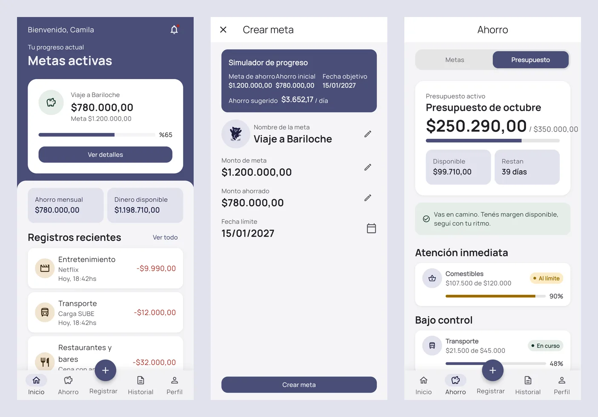
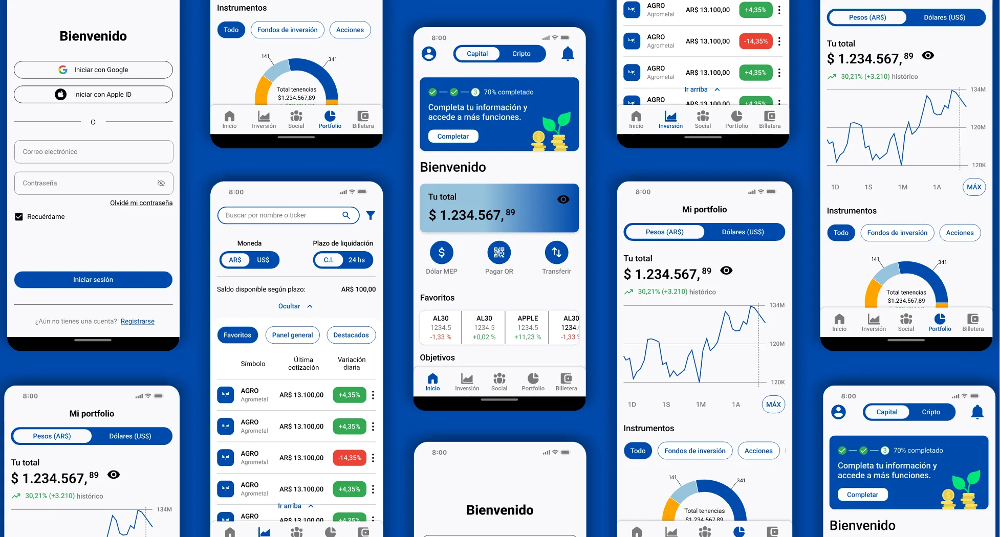

## Hi, I'm Sofía 👋

**Product Designer & Design Engineer** from Buenos Aires, Argentina.

I take products from research to working code. I design in Figma, write the spec, and direct AI-assisted development (Claude Code) until the product is live and tested with real users. Every design decision is mine; the AI implements.

I focus on fintech and personal finance, accessibility (WCAG) and evidence-based design.

**Portfolio:** [sofia-alvarez-ux-iu.vercel.app](https://sofia-alvarez-ux-iu.vercel.app/) · **LinkedIn:** [sofía-álvarez-20](https://www.linkedin.com/in/sof%C3%ADa-%C3%A1lvarez-20/)

---

### Featured work

#### [Milestone](https://github.com/Sofi-Alvarez/Milestone-app) · designed, built and tested solo
A personal finance app for people who stopped tracking their money and want to come back without guilt. Research, architecture, Material Design 3 UI kit, spec-driven build in **Flutter + Firebase**, usability testing and 9 fixes shipped to production.
**SEQ 6.55/7** on the most complex flow · **88.9%** completed the daily log with no help.
[Live app](https://milestone-cc9af.web.app/) · [Code](https://github.com/Sofi-Alvarez/Milestone-app) · [Case study](https://sofia-alvarez-ux-iu.vercel.app/#/case-study/milestone)



#### [Portfolio](https://github.com/Sofi-Alvarez/Portafolio-web) · designed and coded
My portfolio, built in **React + TypeScript + Tailwind** with Claude Code: own design system, light and dark mode, responsive, five full case studies.
[Live site](https://sofia-alvarez-ux-iu.vercel.app/) · [Code](https://github.com/Sofi-Alvarez/Portafolio-web)

#### IUPI · fintech MVP, cross-functional team
Saving and investing wallet for the Argentine market. End-to-end UX/UI in a 5-week team simulation.
[Case study](https://sofia-alvarez-ux-iu.vercel.app/#/case-study/iupi)



#### [Bookie](https://github.com/Sofi-Alvarez/Bookie) · hackathon finalist
Location-based reading app: chapters unlock when you reach a place. Flows, brand, UI kit and prototype.
[Case study](https://sofia-alvarez-ux-iu.vercel.app/#/case-study/bookie) · [Repo](https://github.com/Sofi-Alvarez/Bookie)


---

### How I work

```
Research ─► Architecture ─► Design system ─► Spec ─► AI-assisted build ─► QA ─► Usability testing ─► Iterate
```

- **Design:** Figma (variables, components, Auto Layout), FigJam, Material Design 3, design systems, WCAG
- **Research:** interviews, surveys, usability testing, Maze, Useberry, heuristic evaluation
- **Build:** Claude Code, Claude MCP for Figma (design ↔ code), Figma Make, Lovable, Stitch, Flutter, Firebase, React, Tailwind, HTML, CSS, Git, Vercel
